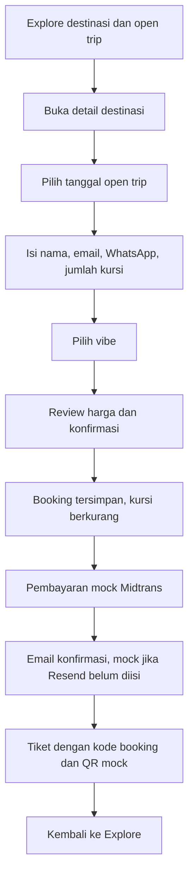
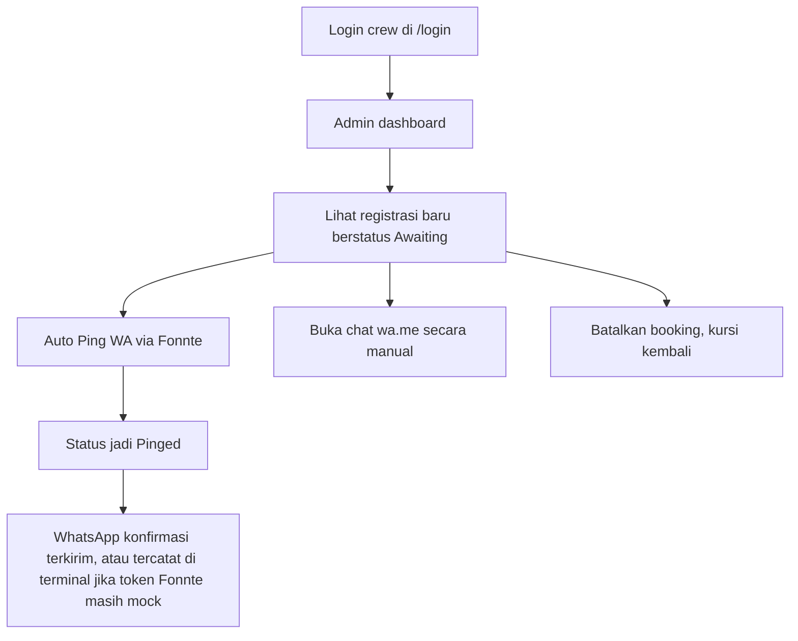
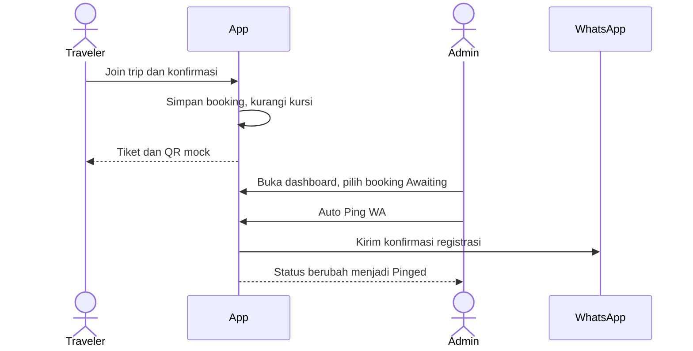
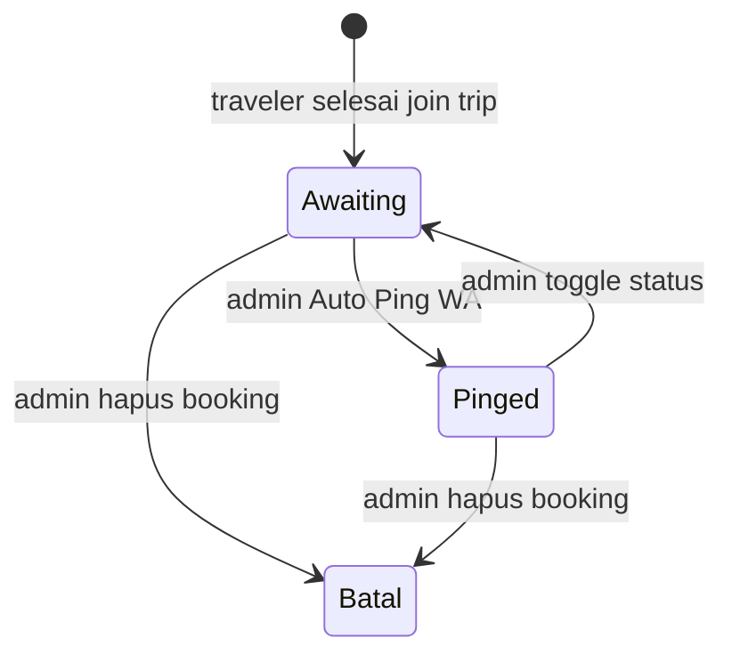

# YoloTrips 🌴 — Casual Travel Web Application

A complete, ready-to-run, vibrant, and casual Travel Web Application designed specifically for Gen Z and millennial travelers. Built with **Next.js 16 (App Router)**, **Tailwind CSS v4**, and **Lucide React** for icons, it features local state persistence for testing booking pipelines without external database requirements.

---

## Alur bisnis

Traveler dan admin adalah dua peran yang terpisah. Traveler selesai setelah dapat tiket. Admin tidak ikut join trip; admin mengambil alih dari dashboard untuk ping WhatsApp dan mengelola registrasi.

### Traveler — join trip sampai tiket



Yang traveler bawa pulang: kode booking seperti `TKT-BALI-1234` dan QR mock. Status di database saat ini `confirmed`, yang di dashboard tampil sebagai **Awaiting**. WhatsApp belum terkirim di langkah ini.

### Admin — operasional setelah ada tiket



Login admin terpisah dari traveler. Akun lokal bawaan: `admin@yolotrips.com` / `admin123`.

### Serah terima



### Status booking



Di database, Awaiting disimpan sebagai `confirmed` dan Pinged sebagai `pinged`. Batal menghapus booking dan mengembalikan kursi.

Traveler tidak melihat pintu admin. Navbar dan footer tidak menautkan dashboard. Crew membuka `http://localhost:3000/admin` langsung. Kalau belum login, aplikasi mengarahkan ke `/login`.

---

## 🎨 Design System & Aesthetics
- **Theme Palette**: Pastel Sand background (`#FCF8F2`), Sunset Orange accents (`#FF6B4A`), and Deep Ocean Teal details (`#14B8A6`).
- **Typography**: Playful yet clean Google Fonts (`Plus Jakarta Sans` for body, `Outfit` for display and headlines).
- **Layout & Interaction**: Glassmorphic floating navigation bar, rounded cards (`rounded-3xl`), micro-interactions, float animations, and animated seats progress trackers.

---

## 🚀 Key Features

1. **Homepage (`app/page.tsx`)**:
   - **Hero Banner**: Catchy headline ("Where to next, buddy? 🌴") with dual search and vibe filtering selectors.
   - **Vibe Checks**: Interactive tabs to filter destinations by travel styles: *Chill Explorer*, *Adrenaline Junkie*, *Foodie*, or *Culture Nomad*.
   - **Featured Cards**: Displaying ratings, tags, pricing, and visual stamps with smooth hover translations.
   - **Open Trip Timelines**: Table schedules showing dates, slots left indicator, progress bars, and direct booking triggers.

2. **Destination Detail Page (`app/destination/[id]/page.tsx`)**:
   - Dynamic route resolving URL parameters via React's `use` hook.
   - **Interactive Packing Checklist**: Check off essential gear as you get ready!
   - **Itinerary Accordion**: Toggleable day-by-day breakdowns with slide animations.
   - **Sidebar checkout widget**: Date selection and instant seat reservation CTA.

3. **Multi-Step Booking Flow (`app/book/[id]/page.tsx`)**:
   - **Step 1**: Contact info (Name, Email, WhatsApp) and seats count controls.
   - **Step 2**: Visual Vibe Selection card grid.
   - **Step 3**: Ticket summary calculation (base price × seats) with purchase confirmation.
   - **Booking Success Ticket**: Confetti animation, mock ticket layout with QR code, and direct booking references (e.g. `TKT-BALI-1234`). Traveler stops here. WhatsApp confirmation is sent later by admin.

4. **Interactive Admin Dashboard (`app/admin/page.tsx`)**:
   - Real-time aggregations (Total Bookings, Revenue, Tickets Sold, Most Popular Vibe).
   - Filterable data table by search keyword, destination spot, or communication status.
   - Interactive commands: "Simulate WhatsApp Ping" and "Cancel Booking" with reactive state changes.
   - Local storage controllers: "Reset Demo Data" (seeds mock records for testing) and "Wipe Storage".

---

## 📂 Project Structure

```bash
yat-app/
├── app/
│   ├── admin/
│   │   └── page.tsx              # Admin View with metric counters and tables
│   ├── book/[id]/
│   │   └── page.tsx              # Multi-step booking form & Success Ticket
│   ├── components/
│   │   ├── Footer.tsx            # Playful Gen Z themed footer
│   │   └── Navbar.tsx            # Floating glassmorphism navbar
│   ├── data/
│   │   └── destinations.ts       # 4 Curated Spots + open trip schedules
│   ├── destination/[id]/
│   │   └── page.tsx              # Details page with checklist & accordions
│   ├── globals.css               # Tailwind imports, colors & animations
│   └── layout.tsx                # Font loading (Outfit & Jakarta) + wrappers
├── public/                       # Core assets & favicon
├── next.config.ts                # Next.js configurations & image remote patterns
├── package.json                  # Dependencies (React 19, Next 16, Lucide React)
└── tsconfig.json                 # TypeScript rules
```

---

## ⚙️ Quick Setup Guide

### 1. Initialize and Enter the Project
Navigate to the directory where the code is written:
```bash
cd /Users/tedysuwega/Workspace/MyProject/Learn/WebApp/yat-app
```

### 2. Install Dependencies
All necessary packages (Next, React, Tailwind, and Lucide React) are configured in `package.json`. Run:
```bash
npm install
```

### 3. Start the Development Server
Launch the local web server:
```bash
npm run dev
```

### 4. Visit the Application
Open your web browser and navigate to:
- **Traveler app**: [http://localhost:3000](http://localhost:3000)
- **Admin login**: [http://localhost:3000/login](http://localhost:3000/login) then [http://localhost:3000/admin](http://localhost:3000/admin). Dashboard tanpa sesi admin akan kembali ke login.
